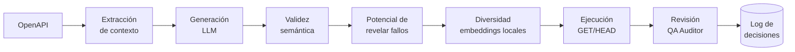

# MetaREST

**Relaciones metamórficas para APIs REST, generadas con un LLM, filtradas automáticamente y revisadas por una persona.**

MetaREST lee la especificación OpenAPI de una API, le pide a un LLM relaciones metamórficas (MRs) candidatas, las
filtra por **validez semántica**, **potencial de revelar fallos** y **diversidad**, ejecuta las que sobreviven contra
la API (solo `GET`/`HEAD`) y se las presenta a un **QA Auditor**, que las acepta o rechaza con justificación. Cada
decisión queda en un log inmutable.

> Proyecto del curso *Digital Transformation and Enterprise Systems* (Escuela Colombiana de Ingeniería Julio
> Garavito, 2026-2).



## Resultados

Evaluado en tres APIs: una API demo con 8 fallos inyectables, [PokeAPI](https://pokeapi.co) y
[Crossref](https://api.crossref.org). El detalle y los comandos para reproducirlo están en
[`experiments/README.md`](experiments/README.md).

| Pregunta | Resultado |
|---|---|
| **RQ1** · Validez | Entre el 85 % y el 100 % de las MRs generadas son válidas. El filtro no subió esa proporción: las 3 inválidas de Crossref dependían de hechos que el spec no dice |
| **RQ2** · Diversidad | La redundancia baja a 0 con el umbral del run, pero en la demo se descartó la única MR que detectaba `wrong_total` |
| **RQ3** · Fallos (demo) | Tradicional 8/8 · manuales 7/8 · **MetaREST 6/8** · manuales + MetaREST 8/8 |
| Cobertura | PokeAPI: 14/15 operaciones con MetaREST frente a 3/15 con MRs manuales. Crossref: 11/18 frente a 5/18 |
| Hallazgo real | `GET /types` de Crossref ignora los parámetros `rows` y `offset` que su OpenAPI documenta |

## Estructura

| Carpeta | Contenido |
|---|---|
| [`backend/`](backend) | FastAPI + Pydantic v2 + Beanie/MongoDB. Pipeline en `app/pipeline/`, contrato de MR en `app/models/mr.py` |
| [`frontend/`](frontend) | Vite + React 18 + TypeScript + Tailwind. Interfaz en español |
| [`sut-demo/`](sut-demo) | API demo (catálogo) con fallos activables por `FAULTS=...` y suite tradicional |
| [`experiments/`](experiments) | Runs congelados, etiquetado, RQ1–RQ3, cobertura, MRs manuales, figuras y protocolo SUS |
| [`infra/`](infra) | Docker Compose (dev y prod), Nginx, CI/CD y backups |
| [`docs/`](docs) | Plan, API, esquema de MR, decisiones del LLM, SUTs e integración |

## Inicio rápido

Requisitos: Docker con Compose v2 y un archivo `backend/.env`. Las variables necesarias están en
[`docs/API.md`](docs/API.md): Mongo, `JWT_SECRET` de al menos 32 caracteres, administrador inicial y la API key del LLM.

```bash
docker compose --env-file backend/.env -f infra/docker-compose.yml up --build -d --wait
```

| Servicio | URL |
|---|---|
| Interfaz web | <http://localhost:8080> |
| Backend (Swagger) | <http://127.0.0.1:8000/docs> |
| API demo | <http://127.0.0.1:8001/docs>. Desde la app se registra como `http://sut-demo:8001` |

Flujo en la interfaz:

1. Crea un proyecto con el OpenAPI de la API.
2. Lanza una iteración y sigue el progreso por etapa.
3. Revisa las candidatas con sus scores y la evidencia de ejecución.

## Desarrollo

```bash
cd backend && uv run pytest                                   # tests del backend
cd backend && uv run ruff check . && uv run ruff format --check .
cd frontend && npm run dev                                    # frontend en modo desarrollo
cd frontend && npm run lint && npm run build && npm test
cd frontend && npm run gen:types                              # regenera los tipos desde los esquemas
```

Los tests usan un `FakeLLMProvider`: nunca llaman al LLM real. Las convenciones del equipo están en
[`AGENTS.md`](AGENTS.md).

## Seguridad

- El ejecutor solo hace peticiones `GET`/`HEAD` contra la API bajo prueba.
- Las descripciones del OpenAPI se tratan como datos no confiables y van delimitadas en los prompts.
- Las respuestas de la API nunca se envían al LLM. Toda salida del LLM se valida con Pydantic.
- Las credenciales viven en `.env`, nunca en el código. La colección `decisions` es *append-only*.
- Autenticación con JWT y bcrypt, con tres roles: Administrador, QA Auditor y Observador.

## Documentación

| Documento | Tema |
|---|---|
| [`docs/PLAN.md`](docs/PLAN.md) | Plan del MVP, arquitectura y cronograma |
| [`docs/API.md`](docs/API.md) | Endpoints, permisos y configuración del backend |
| [`docs/MR_SCHEMA.md`](docs/MR_SCHEMA.md) | Modelo de MR ejecutable: transformaciones y relaciones |
| [`docs/LLM.md`](docs/LLM.md) | Proveedores, modelos y decisiones de calibración |
| [`docs/SUTS.md`](docs/SUTS.md) | Por qué se eligieron las APIs evaluadas |
| [`docs/INTEGRATION.md`](docs/INTEGRATION.md) | Cómo se conectan pipeline, plataforma y experimentos |
| [`docs/CHECKLIST.md`](docs/CHECKLIST.md) | Estado del proyecto |
| [`infra/README.md`](infra/README.md) | Entorno local, producción y backups |
| [`sut-demo/README.md`](sut-demo/README.md) | Contrato de la API demo y sus fallos |

## Equipo

| Persona | Área |
|---|---|
| Daniel Patiño Mejia | Pipeline de IA (generación, filtros, ejecución) y experimentos |
| Nestor David Lopez Castañeda | Plataforma backend, API demo e infraestructura |
| Isaac David Burgos Cervantes | Frontend, MRs manuales, figuras y protocolo SUS |

Profesor: Luis Daniel Benavides Navarro.

## Licencia

[MIT](LICENSE)
